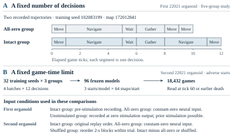
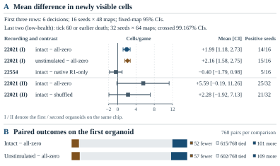

<h1 align="center">生物信号引导的 LLM 强化学习</h1>
<p align="center">把类器官电活动离线回放给生存游戏里的语言模型，它下一步会去哪里？项目中的“引导”指策略和价值网络接收这些生物信号读数。</p>
<p align="center"><a href="paper.pdf">署名论文（PDF）</a> · <a href="#游戏实录">播放游戏实录</a> · <a href="original/">游戏和训练源码</a> · <a href="docs/data-access.md">原始数据</a> · <a href="https://github.com/brainintelli/organoid-replay-survival/releases/tag/model-training-archives-v1">模型与历史归档（私有）</a> · <a href="README.md">English</a></p>

**论文**　*Language Model Exploration and Survival Behavior Under Offline Replay of Organoid Neural Signals*

**作者**　Brainintelli Research Lab · Brainintelli，上海，中国 · [research@brainintelli.com](mailto:research@brainintelli.com)

在生存游戏里，语言模型每次都可以选择移动一格、导航到地标，或停下来采集物资。每个选项消耗的游戏时间不同。模型接收离线回放的类器官电活动记录后，能否在**相同的游戏时长内**探索更多新格？我们也在低生命值开局衡量探索，在严重缺水或饥饿开局衡量存活。生命值和寻找水源的行动都可以测量，单凭这些行为无法推断模型主观上是否感到恐惧。

## 游戏实录

https://github.com/user-attachments/assets/6b501274-535f-4aa3-bf73-9e032d7c6809

可以同时看湖边的角色和右侧的行动日志。界面分别记录决策次数和已过去的游戏时间，上方的状态栏显示生命值、饱食度和水分。这段约 41 秒的录像展示游戏如何运行。下文的组间比较来自按种子和地图配对的多局记录。[观看导读与时间点](docs/video.md) · [原始 MP4](media/gameplay.mp4)

## 下载代码、记录和模型

训练与评估回执已可供获邀者下载。其余私有分卷正在上传和校验，整包 SHA-256 核对完成后开放下载。

| 材料 | 获取方式 |
|---|---|
| 论文、原始工程、逐局数据和分析 | [论文 PDF](paper.pdf) · [源码导览](docs/original-source.md) · [逐局表](data/exploration.csv) · [复现命令](docs/reproduction-guide.md)。无需登录 GitHub。 |
| 182 份原始 H5 电生理记录 | [打开夸克分享](https://pan.quark.cn/s/3f2e5122ab68)，输入提取码 **`mFFv`**。下载后按[文件清单和 SHA-256](docs/data-access.md)核验。 |
| 模型 checkpoint、优化器状态与历史大包 | [私有 GitHub Releases 分卷下载](https://github.com/brainintelli/organoid-replay-survival/releases/tag/model-training-archives-v1) · [选包、重组与 SHA-256 校验说明](docs/archive-downloads.md)。使用获得归档权限的账号登录；未经邀请时 GitHub 会显示 404。 |
| 原始训练和逐局评估回执 | [下载已校验的回执 ZIP（私有）](https://github.com/brainintelli/organoid-replay-survival/releases/tag/study-evidence-v1)。该包用于从电极读数和已记录的决策重建恶劣开局试验结果。 |

## 一段电极记录怎样进入一次游戏决策？

1. **读取一秒钟的电活动。** 微电极阵列（MEA）记录放电时刻和通道。对每个一秒时间窗，研究者计算四项读数：每个入选通道的平均放电次数经对数变换后的值、有放电的通道占比、放电在时间上的集中程度，以及放电在各通道间的分布熵。该窗内没有放电的入选通道也计入分母。研究者使用校准记录的中位数和中位绝对偏差，把四项读数缩放到共同的有界范围。
2. **把信号与游戏状态一起交给模型。** Qwen3.5-0.8B 的提示词中既有这四项读数，也有地形、地标、物品栏和资源状态。价值网络收到相同的读数。在全零组，两条输入分支都在**校准之后**将四项读数置零。每次行动的游戏结果会反馈给模型；电活动按预定顺序离线回放，组织收不到游戏动作的反馈。
3. **记录哪些参数接受了训练。** PPO 更新策略适配器，语言模型基座保持冻结，价值网络单独更新。短程试验中，每个模型采集四批轨迹，每批 12 次决策，合计进行八步策略更新、64 步价值更新。芯片 22021 的附加奖励权重为零，评估时各组继续使用训练时的输入方案。因此，组间差异同时包含训练阶段和评估当下采用该方案的影响。
4. **在相同起点上，分别按两种时间口径比较。** 研究者按训练种子和地图配对，先比较每局六次决策后新揭示了多少格，再把同一批轨迹事后截断到游戏的第六个时间步。恶劣开局试验则从设计之初就固定游戏时限：在低生命值开局衡量探索，在严重缺水或严重饥饿开局衡量存活。



*图 3。* 两个智能体做出同样多次决策后，可以停在不同的游戏时间步。按决策次数比较，和按实际经过的游戏时间比较，回答的是两个问题。[查看大图](figures/fig03.svg) · [信号处理与策略更新，见图 1–2](figures/)

## 每个对照分别回答什么问题？

| 试验 | 输入与配对方式 | 可以回答的问题 |
|---|---|---|
| 短程探索，芯片 22021 的第一枚类器官 | 每组 16 个训练种子，各在相同的 48 张地图上评估。**原样组**使用首次刺激前的记录。**未刺激组**使用较晚时段的实测记录，当时刺激输出指令为零，此前可能已有刺激暴露。**全零组**接收常数零向量。 | 在这组地图上，不同输入方案对应的新揭示格数相差多少。两段实测记录也来自不同的生物时段，刺激历史可能不同。 |
| 恶劣开局，芯片 22021 的第二枚类器官 | 每种开局、每组均为 32 个种子 × 64 张地图。**原样组**按记录顺序回放，**打乱组**在每次试验内部重排两秒数据块，**全零组**将输入置零。共 96 个冻结模型，评估 18,432 局。 | 在相同场景和地图上，保留记录顺序是否与低生命值开局的探索表现有关，以及严重缺水、严重饥饿开局在第 60 个游戏时间步的存活表现如何。 |
| 芯片 22554 的独立记录 | 两个 MEA 组在**训练试次之间的配对关系**上有差别，评估时接收相同的有序记录。另设一个只使用游戏原生奖励的智能体作为对照。 | 在这一实现下，短程探索的结果能否在另一枚芯片上重现。这里打乱训练试次的配对，和芯片 22021 中打乱单次试验内部的数据块，属于两种不同的干预。 |

## 从逐局测量中能看出什么？

在第一枚类器官记录及固定的 48 张地图上，六次决策后，原样组比全零组**平均每局多揭示 1.99 格**（固定地图的 95% 区间为 **1.18 至 2.73 格**）。768 对配对对局中，原样组有 **101 对**探索更多、**615 对**持平、**52 对**探索更少，配对差的中位数为**零**。多数对局的探索格数相同。读者可以按训练种子和地图找出贡献均差的对局，并对照两个智能体所选的动作类别。[逐步动作类别表](data/actions.csv)

固定实际经过的游戏时间后，同时对种子与地图重采样所得的区间跨零。芯片 22554 未复现短程探索结果。恶劣开局的六项主要比较区间均跨零。在两天的采集记录中，也未检出规律刺激或随机刺激带来可重复的探索或得分收益。第一天的一项子试验中，原样组与全零组得分差的 **84.3%**、未刺激组与全零组得分差的 **95.9%** 来自动作耗时对应的计时得分。对于动作耗时不一的智能体，**用什么时钟计时、用什么终点衡量表现**，会影响对结果的解读。仅凭较高的分数无法判断模型作出了更有利于存活的决策。现有比较也无法确定匹配的合成输入是否会产生相似结果，或组间差异有多少来自推理时接收的输入。



*图 5。* 三项六次决策比较在地图固定条件下重采样训练种子，区间水平为 95%。两项低生命值开局比较同时重采样种子和地图，区间水平为 99.167%。下方列出第一枚类器官记录的逐局配对结果分布。[查看大图](figures/fig05.svg) · [逐局对照数据](data/exploration.csv)

**预注册与审计记录。** 恶劣开局试验的 64 张地图和八个种子曾用于先导研究。评估结束后，18,720 份回执的设计标识有过更新，其中 99 份留有更改前副本可供核对。评估时未能取得登记的审计游戏源码，场景核验文件的哈希也与登记值不一致。论文第 5、8 节与附录 B 分别说明了这些偏离和后续重放核验能覆盖的范围。[论文全文](paper.pdf) · [来源说明](docs/source-notes.md)

## 复现与项目入口

在仓库根目录，用 Python 3.12 运行：

```sh
python -m src.reproduce smoke
python -m src.reproduce exploration
```

两条命令都可使用仓库自带的逐局配对数据离线运行。每次运行会新建结果目录，保存输出和输入文件的哈希。区间估计、其他终点和绘图命令见[复现指南](docs/reproduction-guide.md)。

| 想查看的内容 | 从这里进入 |
|---|---|
| 游戏、智能体、训练工具、采集程序及历史源码快照 | [原始项目](original/) · [源码清单与收录范围](docs/original-source.md) |
| 论文对应的训练、评估和 PPO 代码 | [历史运行入口](historical/README.md) · [分析源码](src/) |
| 原始电生理数据 | [夸克网盘](https://pan.quark.cn/s/3f2e5122ab68) · 提取码 **`mFFv`** · [采集索引、校验值与访问说明](docs/data-access.md) |
| 原始逐局配对表、汇总表、模型索引和派生测量 | [原始数据表](data/upstream/) · [数据字典](data/data_dictionary.csv) · [数据卡](data/datasheet.md) |
| 哪些结果可以重算，哪些需要额外材料 | [逐项复现矩阵](docs/reproduction_matrix.csv) · [运行环境](docs/environment.md) · [项目内容与剩余依赖](docs/project-contents.md) |
| 图、绘图代码和可编辑论文 | [图与绘图代码](figures/) · [论文源文件](manuscript/) · [Word 版](manuscript/paper.docx) |

[代码许可](LICENSE) · [数据许可](LICENSE-DATA) · [引用信息](CITATION.cff)
